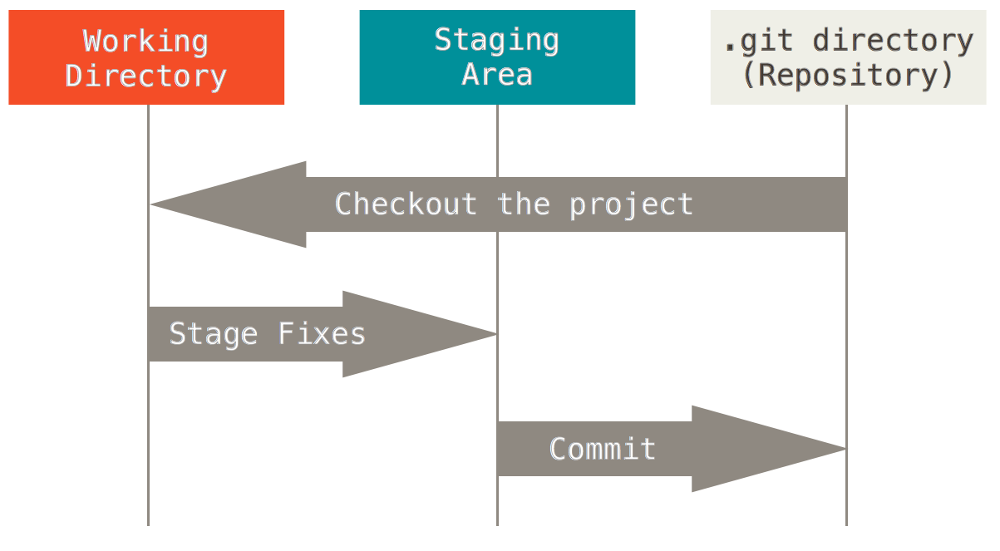
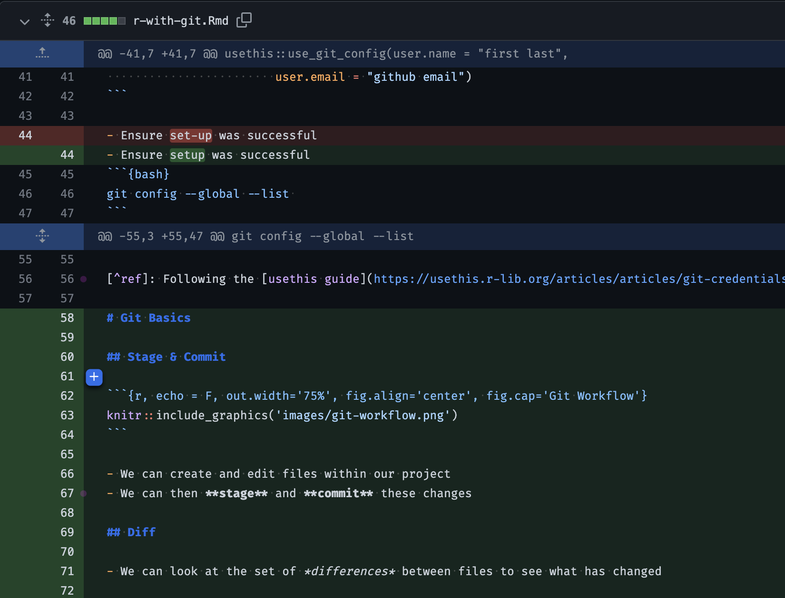
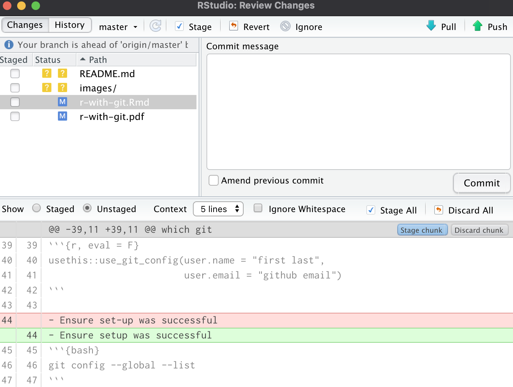
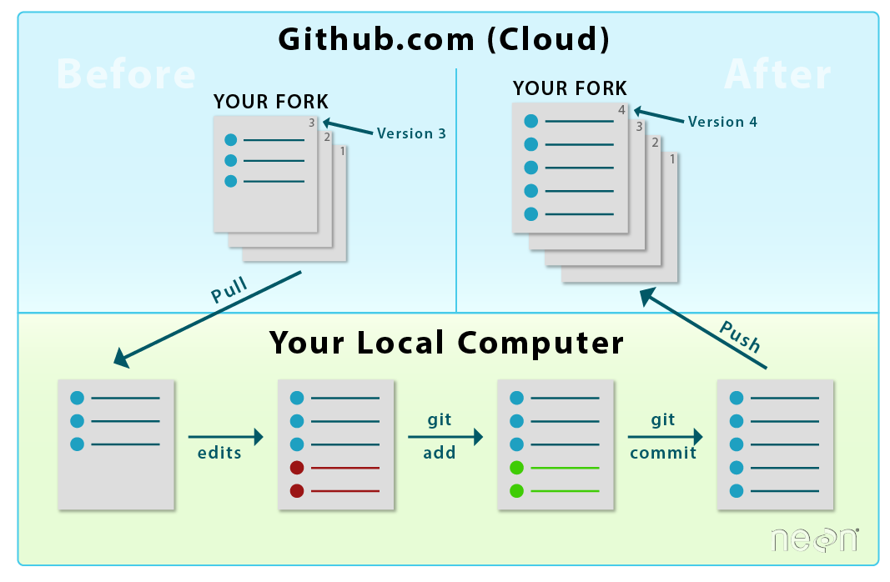

## What is Git?

-   Git is a version control system
-   It allows you to track changes made to files
-   Let's the user
    -   Save versions
    -   Compare changes
    -   Revert back

## Installation {.scrollable}

-   Check if git is already installed: `which git`

. . .

-   If not, install it

::: {.panel-tabset}
### Windows
Consult <https://gitforwindows.org/> for guidance.

### Mac
```bash
# Using homebrew
brew install git

# Using macports
sudo port install git
```

### Linux
```bash
# Ubuntu or Debian
sudo apt-get install git

# Fedora or RedHat
sudo yum install git
```
:::

. . .

-  And, configure it

::: {.panel-tabset}
### Bash
```bash
# Introduce yourself to git
git config --global user.name "First Last"
git config --global user.email "Email Address"

# Check setup
git config --global --list
```

### R
```{r}
# Introduce yourself to git
usethis::use_git_config(
  user.name = "First Last",
  user.email = "Email Address"
)

# Check setup
usethis::edit_git_config()
```
:::

# Git Basics

## Initialization

::: {.incremental}
- In order to work with git, we must obtain a git repository.
- One way to do so is through **initialization**, which tells git to track
changes moving forwards.[^1]
- This process creates a new `.git` subdirectory that contains all of your
necessary repository files.
- To do so, we use:

  ::: {.panel-tabset}
  ### Bash
  ```{.bash}
  git init
  ```

  ### R
  ```{r}
  usethis::use_git()
  ```

  :::
:::

[^1]: Alternatively, you can **clone** an existing git repository from
somewhere.

## Making Changes

::: {.incremental}
- We create and edit files within our repository
- We then **stage** any changes

  
:::

## Diff

- To help understand our changes, we can look at the set of *differences*
between files.

::: {layout-ncol=2}



:::

## Commit Best Practices

Each commit should be:

- *Minimal:* A commit should only contain changes related to a single problem
    or feature
- *Complete:* A commit should add the functionality it claims to add
- *Concise, yet evocative:* At a glance, you should be able to understand what
    a commit does, but you should include enough detail so you can remember
    what was done

## Time Travel

- Can look at old commits and access old code
- Can use your git client or Github
- Can revert back to a previous commit

## Pull & Push Changes

- **Pulling** changes from Github allows us to access stored changes
- **Pushing** changes stores changes on Github


